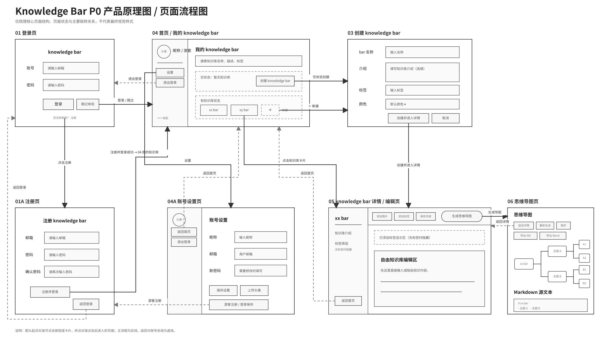
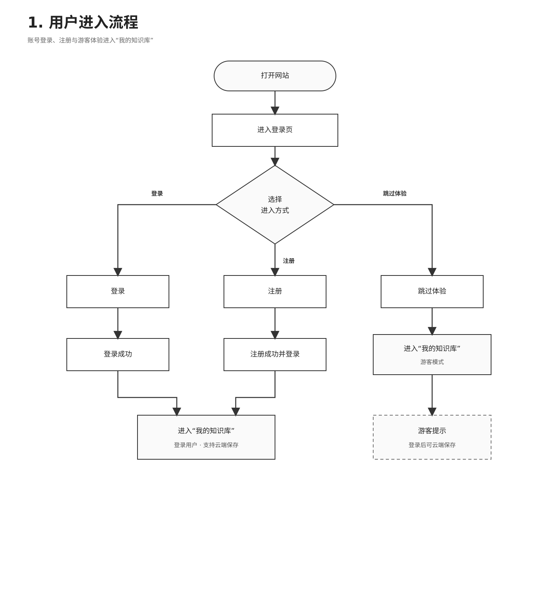
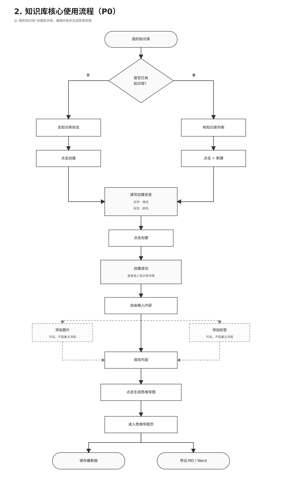
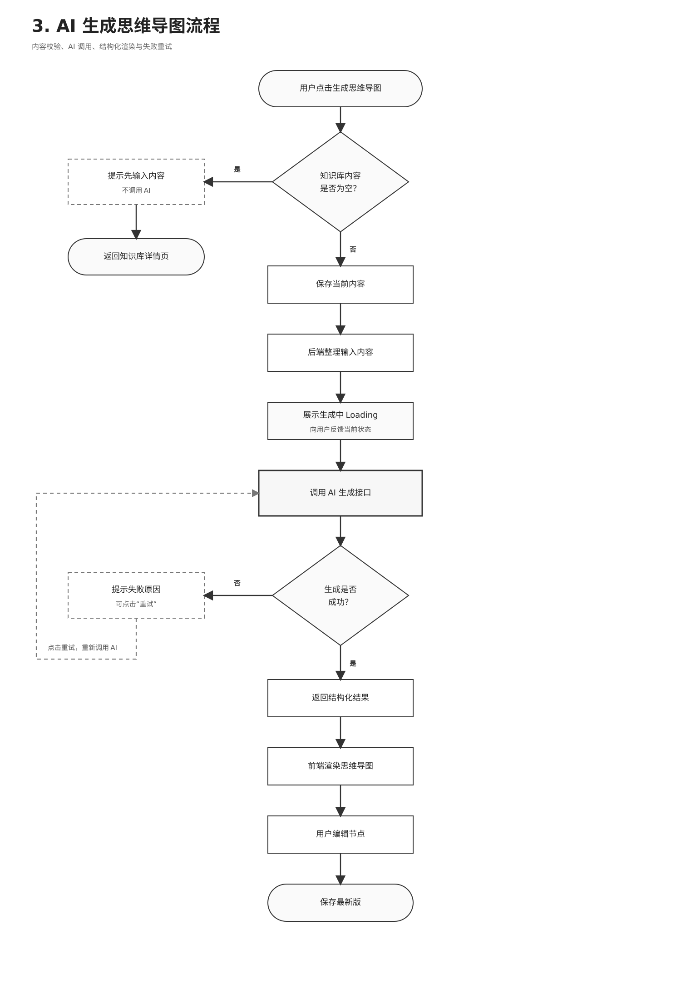

# Knowledge Bar P0 第一版 PRD

## 1. 修订记录

| 版本 | 日期 | 修订人 | 修订内容 |
| --- | --- | --- | --- |
| 0.1 | 2026-07-29 | 产品负责人 | 创建 Knowledge Bar P0 第一版 PRD，明确产品定位、P0 范围、核心流程和页面结构 |

## 2. 背景简介

### 2.1 项目背景

在学习过程中，很多学生和备考用户会把资料分散记录在不同地方，例如课堂笔记、电子文档、截图、复制的文字资料和临时整理的复习内容。随着学习内容增加，用户容易遇到三个问题：

1. 笔记内容零散，后续复习时很难快速找到重点。
2. 知识之间缺少结构，用户需要额外花时间整理框架。
3. 现有工具要么偏文档记录，要么偏专业绘图，对普通学习用户来说门槛较高。

Knowledge Bar 希望解决的是：让用户可以像写空白文档一样自由输入和沉淀学习资料，再通过 AI 把内容整理成可查看、可编辑、可保存、可导出的思维导图。

### 2.2 产品定位

Knowledge Bar 是一款面向学习场景的 AI 知识整理工具。P0 第一版定位为：

> 自建知识库 + AI 可编辑思维导图生成器

第一版不做复杂知识图谱，不做 OCR，不做网页链接解析，不做 AI 聊天助手。核心目标是先跑通“创建知识库 - 输入内容 - 生成思维导图 - 保存/导出”的最小闭环。

## 3. 产品目标与用户价值

### 3.1 用户价值

Knowledge Bar 的核心用户价值是帮助用户降低整理学习资料的成本。用户不需要一开始就理解复杂的知识图谱，也不需要学习专业绘图工具，只需要像写空白文档一样输入或粘贴自己的学习内容，系统就可以通过 AI 帮助用户生成结构化的思维导图。

| 用户价值 | 说明 |
| --- | --- |
| 降低整理成本 | 用户可以把零散文字、复习资料、课堂笔记集中放入一个知识库 |
| 提升结构化效率 | AI 根据用户输入内容生成思维导图，帮助用户快速看到知识框架 |
| 保留编辑自由度 | 用户不被固定模板限制，可以自由书写、保存、修改内容 |
| 支持学习沉淀 | 登录用户可以云端保存知识库，后续继续编辑和复习 |
| 支持成果导出 | 用户可以导出 Markdown 或 Word，用于复习、整理、分享或作品集展示 |

### 3.2 产品目标

Knowledge Bar P0 第一版需要同时体现 AI 产品能力和完整 SaaS 产品能力。

| 目标方向 | P0 目标 |
| --- | --- |
| AI 产品能力 | 支持用户基于知识库内容生成可查看、可编辑、可保存的思维导图 |
| SaaS 产品能力 | 支持账号登录、游客体验、知识库创建、云端保存、工作台管理和文件导出 |
| 用户体验目标 | 降低使用门槛，让用户进入后能快速理解“创建知识库 - 写内容 - 生成思维导图”的路径 |
| 上线目标 | 完成前端、后端、数据库部署，形成一个真实可访问的作品集项目 |
| 后续扩展目标 | 为 OCR、网页链接解析、AI 学习助手、会员限制、知识图谱等能力预留扩展空间 |

### 3.3 P0 成功标准

| 成功标准 | 验收描述 |
| --- | --- |
| 主流程完整 | 用户可以完成注册/登录或跳过体验，创建知识库，编辑内容，生成思维导图，保存并导出 |
| AI 能力可演示 | 用户输入一段学习资料后，系统可以生成结构清晰的思维导图 |
| SaaS 结构完整 | 项目具备账号体系、用户数据归属、知识库管理、后端接口和数据库保存 |
| 使用门槛低 | 用户不需要学习复杂编辑器，进入详情页后可以直接写内容 |
| 可真实上线 | 前端部署到 Vercel，后端部署到 Railway 或 Render，数据库使用 Supabase PostgreSQL |
| 作品集可展示 | 页面视觉统一，流程完整，能说明产品思考、AI 能力、技术架构和上线成果 |

## 4. 目标用户与使用场景

### 4.1 目标用户优先级

Knowledge Bar P0 第一版优先服务有大量学习资料整理需求的用户。第一版不面向所有学习人群，而是优先覆盖资料量大、复习周期长、需要结构化整理的用户。

| 用户类型 | 优先级 | 用户特点 | 核心需求 |
| --- | --- | --- | --- |
| 大学生 | P0 | 课程资料分散，笔记来源多，包括课堂笔记、PPT 摘录、教材内容和临时复习资料 | 把课程内容整理成结构清晰的复习框架 |
| 考研用户 | P0 | 学习周期长，资料量大，知识点密集，需要反复复习 | 快速整理章节内容，生成便于背诵和复盘的思维导图 |
| 考公用户 | P0 | 复习内容模块化明显，例如行测、申论、常识等 | 按模块沉淀知识点，并快速生成复习结构 |
| 职业学习者 | P1 | 需要学习专业知识、技能课程或行业资料 | 后续版本支持更长期的个人知识沉淀 |
| 中学生 | 暂不考虑 | 学习场景、家长角色、课程体系和使用方式不同 | P0 不做针对性设计 |

### 4.2 核心使用场景

| 场景 | 用户行为 | 当前痛点 | Knowledge Bar 的解决方式 |
| --- | --- | --- | --- |
| 课程笔记整理 | 大学生把课堂笔记、PPT 摘录或复习资料输入到知识库中 | 内容分散，复习时难以快速看到知识结构 | 用户在知识库详情页自由书写内容，AI 生成思维导图 |
| 考研章节复习 | 考研用户按章节整理政治、英语、专业课等资料 | 章节内容多，手动画框架耗时 | 用户输入章节内容后，一键生成可编辑思维导图 |
| 考公模块整理 | 考公用户整理行测、申论、常识等模块知识点 | 模块多，知识点容易混乱 | 用户按知识库或标签沉淀内容，后续生成结构化导图 |
| 临时资料沉淀 | 用户看到一段有价值的资料，想先保存下来 | 资料容易散落在聊天记录、文档或截图中 | 用户可以直接复制文字进入知识库，后续再整理 |
| 复习成果导出 | 用户希望把整理好的内容用于复习或分享 | 普通笔记不方便转换成复习结构 | 用户导出 Markdown 或 Word，作为复习资料继续使用 |

### 4.3 P0 用户边界

P0 第一版不追求覆盖所有学习场景，重点验证“自由输入资料 + AI 生成思维导图”的核心闭环。

| 暂不支持场景 | 原因 |
| --- | --- |
| 中学生学习场景 | 用户年龄、课程体系、家长角色和产品表达方式不同，需要单独设计 |
| 团队协作知识库 | P0 先验证个人知识整理闭环，多人协作会显著增加权限和数据复杂度 |
| 专业知识图谱构建 | 图谱关系、节点连接和图数据库会扩大开发范围，第一版先做思维导图 |
| 图片 OCR 自动识别 | OCR 涉及识别准确率、图片处理和失败场景，后续版本再做 |
| 网页链接自动解析 | 涉及网页抓取、内容清洗、版权和失败处理，P0 暂不做 |

## 5. P0 范围说明

### 5.1 P0 核心闭环

Knowledge Bar P0 第一版只围绕一个核心闭环展开：

> 用户创建一个 knowledge bar，在其中自由输入或粘贴学习内容，再通过 AI 生成可编辑的思维导图，并保存或导出结果。

P0 不追求一次性完成完整知识管理系统，而是优先验证以下能力：

1. 用户能否顺利创建并管理自己的知识库。
2. 用户能否像写空白文档一样低门槛输入学习资料。
3. AI 能否把用户输入内容整理成结构化思维导图。
4. 登录用户的数据能否保存到云端。
5. 项目能否作为一个真实 SaaS 产品上线访问。

### 5.2 P0 必做范围

| 模块 | 功能 | 优先级 | 说明 |
| --- | --- | --- | --- |
| 账号 | 邮箱密码注册 | P0 | 用户可以通过邮箱和密码创建账号 |
| 账号 | 邮箱密码登录 | P0 | 登录后用户数据可云端保存 |
| 账号 | 跳过体验 / 游客模式 | P0 | 用户可不登录先体验核心流程，但需提示登录后才能云端保存 |
| 工作台 | 我的知识库列表 | P0 | 展示当前用户创建的知识库 |
| 工作台 | 无知识库空状态 | P0 | 没有知识库时，引导用户创建 |
| 工作台 | 搜索知识库 | P0 | 支持按名称、描述、标签搜索 |
| 知识库 | 创建知识库 | P0 | 字段包括名称、描述、标签、颜色 |
| 知识库 | 创建后进入详情页 | P0 | 创建成功后直接跳转到知识库详情页 |
| 知识库 | 编辑知识库信息 | P0 | 支持修改名称、描述、标签、颜色 |
| 知识库 | 删除知识库 | P0 | 删除前需要二次确认 |
| 编辑器 | 自由文档编辑 | P0 | 用户可以直接输入或粘贴文字内容 |
| 编辑器 | 保存内容 | P0 | 保存当前知识库文档内容 |
| 编辑器 | 添加图片入口 | P0 | 支持上传图片并插入文档，P0 不做 OCR |
| 编辑器 | 添加标签 | P0 | 用户选中文本后可以添加标签 |
| AI | 生成思维导图 | P0 | 基于知识库内容生成结构化导图 |
| 思维导图 | 查看思维导图 | P0 | 展示 AI 生成结果 |
| 思维导图 | 编辑节点文字 | P0 | 用户可以修改生成后的节点内容 |
| 思维导图 | 保存最新版 | P0 | 只保存最新版本，不做历史版本 |
| 导出 | 导出 Markdown | P0 | 导出知识库内容或思维导图结构 |
| 导出 | 导出 Word | P0 | 导出为 Word 文件 |
| 设置 | 账号基础设置 | P0 | 支持昵称、邮箱、密码、头像入口 |

### 5.3 P0 明确不做范围

| 不做功能 | 原因 | 后续规划 |
| --- | --- | --- |
| 复杂知识图谱 | 图谱节点关系、跨知识库关联和图数据库会显著增加复杂度，P0 先验证思维导图闭环 | P2 |
| 图片 OCR | OCR 涉及识别准确率、图片处理、失败重试和成本控制 | P1 |
| 网页链接解析 | 涉及网页抓取、内容清洗、版权和解析失败处理 | P1 |
| AI 聊天助手 | 会分散第一版核心目标，且需要额外设计上下文和对话保存 | P1/P2 |
| 学习计划 / 测验 | 属于学习增强能力，P0 先不做 | P1 |
| 会员系统 / 次数限制 | 商业化相关，P0 可预留字段但不实现 | P2 |
| 团队协作 | 涉及多人权限、共享、协同编辑和通知机制 | P2 |
| 多版本历史 | P0 只保存最新版，降低数据和交互复杂度 | P1 |
| 第三方登录 | P0 先做邮箱密码，降低开发成本 | P1 |
| 忘记密码 | 第一版可暂不做，后续完善账号体系时补充 | P1 |

### 5.4 P0 范围判断原则

| 判断问题 | 如果答案是“否” |
| --- | --- |
| 是否直接服务“创建知识库 - 输入内容 - 生成思维导图 - 保存/导出”闭环？ | 不进入 P0 |
| 是否影响用户首次完成核心流程？ | 不进入 P0 |
| 是否会明显增加后端、数据库或 AI 成本复杂度？ | 优先放入 P1/P2 |
| 是否没有它产品就无法作为 SaaS 上线？ | 不进入 P0 |
| 是否能在作品集中明显体现产品完整度或 AI 能力？ | 视开发成本决定 |

## 6. 产品原理图与核心流程图

### 6.1 产品原理图 / 页面流程图

产品原理图用于说明 Knowledge Bar P0 的页面结构、页面状态和主要跳转关系。该图不代表最终视觉 UI，仅用于确认产品流程、信息层级、页面状态和核心操作路径。



说明：主流程为实线，返回、退出登录、游客注册等辅助路径为虚线。

### 6.2 用户进入流程图

用户进入流程图用于说明用户第一次打开网站后，如何通过登录、注册或游客模式进入“我的知识库”。



### 6.3 知识库核心使用流程图

知识库核心使用流程图用于说明用户从“我的知识库”进入，完成创建知识库、编辑内容、生成思维导图、保存和导出的 P0 主流程。



### 6.4 AI 生成思维导图流程图

AI 生成思维导图流程图用于说明生成前校验、生成中反馈、成功渲染、失败重试和保存逻辑。



## 7. 页面与交互说明

### 7.1 页面列表

| 页面编号 | 页面名称 | 页面目标 | 入口 | 成功出口 |
| --- | --- | --- | --- | --- |
| 01 | 登录页 | 让用户登录、注册或跳过体验 | 打开网站默认进入 | 登录成功 / 跳过体验后进入“我的知识库” |
| 01A | 注册页 | 让新用户创建账号 | 登录页点击“注册” | 注册成功并登录后进入“我的知识库” |
| 03 | 创建 knowledge bar | 创建新的知识库 | 我的知识库页点击“创建”或“+ 新建” | 创建成功后进入知识库详情页 |
| 04 | 我的 knowledge bar | 展示和管理用户的知识库 | 登录、注册成功或跳过体验后进入 | 点击知识库卡片进入详情页 |
| 04A | 账号设置页 | 修改基础账号信息 | 侧边栏点击“设置” | 保存后停留当前页或返回首页 |
| 05 | knowledge bar 详情 / 编辑页 | 编辑知识库内容并触发 AI 生成 | 点击知识库卡片或创建成功后进入 | 点击生成思维导图进入思维导图页 |
| 06 | 思维导图页 | 查看、编辑、保存和导出 AI 生成结果 | 详情页点击“生成思维导图” | 保存 / 导出 / 返回详情页 |

### 7.2 登录页

| 项目 | 说明 |
| --- | --- |
| 页面目标 | 让用户通过登录、注册或跳过体验进入产品 |
| 页面入口 | 用户打开网站默认进入 |
| 页面主要内容 | 产品品牌区、邮箱输入框、密码输入框、登录按钮、跳过体验按钮、注册入口 |
| 主要操作 | 登录、跳过体验、进入注册页 |
| 成功跳转 | 登录成功后进入“我的 knowledge bar”；跳过体验后进入“我的 knowledge bar”游客模式 |
| 异常状态 | 邮箱为空、邮箱格式错误、密码为空、账号或密码错误、网络请求失败 |
| 页面反馈 | 登录中按钮进入 Loading 状态；登录失败时展示错误提示；游客模式展示“登录后可云端保存”提示 |
| P0 不做 | 第三方登录、忘记密码、邮箱验证码登录 |

### 7.3 注册页

| 项目 | 说明 |
| --- | --- |
| 页面目标 | 让新用户创建账号并直接进入产品 |
| 页面入口 | 登录页点击“注册” |
| 页面主要内容 | 邮箱输入框、密码输入框、确认密码输入框、注册并登录按钮、返回登录按钮 |
| 主要操作 | 注册并登录、返回登录页 |
| 成功跳转 | 注册成功后自动登录，并进入“我的 knowledge bar” |
| 异常状态 | 邮箱为空、邮箱格式错误、密码为空、两次密码不一致、邮箱已注册、网络请求失败 |
| 页面反馈 | 注册中按钮进入 Loading 状态；注册失败展示错误原因；注册成功后直接跳转 |
| P0 不做 | 邮箱验证码、第三方注册、用户协议弹窗、忘记密码 |

### 7.4 创建 knowledge bar 页

| 项目 | 说明 |
| --- | --- |
| 页面目标 | 让用户创建一个新的知识库 |
| 页面入口 | “我的 knowledge bar”页空状态点击“创建 knowledge bar”，或有知识库状态点击“+ 新建” |
| 页面主要内容 | bar 名称、介绍、标签、颜色、创建并进入详情按钮、取消按钮 |
| 必填字段 | bar 名称 |
| 可选字段 | 介绍、标签、颜色 |
| 主要操作 | 创建 knowledge bar、取消创建 |
| 成功跳转 | 创建成功后直接进入 05 knowledge bar 详情 / 编辑页 |
| 异常状态 | 名称为空、名称过长、创建失败、网络请求失败 |
| 页面反馈 | 创建中按钮 Loading；创建失败展示错误提示；取消后返回“我的 knowledge bar” |
| P0 不做 | 知识库模板、批量创建、从文件导入创建 |

### 7.5 我的 knowledge bar 页

| 项目 | 说明 |
| --- | --- |
| 页面目标 | 展示用户已有知识库，并引导用户创建或进入知识库 |
| 页面入口 | 登录成功、注册成功、跳过体验后进入 |
| 页面主要内容 | 左侧账号侧栏、页面标题、搜索框、空状态、有知识库列表、新建入口 |
| 左侧侧栏 | 展示头像、昵称 / 游客状态、游客保存提示、设置入口、退出登录入口、收起侧边栏按钮 |
| 搜索范围 | 知识库名称、描述、标签 |
| 空状态 | 当用户没有知识库时，展示“暂无知识库”提示和“创建 knowledge bar”按钮 |
| 有数据状态 | 展示知识库卡片，卡片包含名称、描述、标签、颜色、创建时间 / 更新时间 |
| 主要操作 | 搜索知识库、创建知识库、点击知识库卡片、进入设置、退出登录、收起侧边栏 |
| 成功跳转 | 点击创建进入 03 创建 knowledge bar 页；点击卡片进入 05 knowledge bar 详情页；点击设置进入 04A 账号设置页 |
| 异常状态 | 知识库列表加载失败、搜索无结果、游客数据刷新丢失 |
| 页面反馈 | 列表加载中展示 Loading；搜索无结果展示空提示；游客模式提示“登录后可云端保存” |
| P0 不做 | 知识库排序、批量删除、拖拽分组、分享知识库 |

#### 7.5.1 空状态

| 项目 | 说明 |
| --- | --- |
| 触发条件 | 当前用户没有任何知识库 |
| 页面表现 | 主内容区展示空状态提示 |
| 主按钮 | 创建 knowledge bar |
| 点击结果 | 进入 03 创建 knowledge bar 页 |

#### 7.5.2 有知识库状态

| 项目 | 说明 |
| --- | --- |
| 触发条件 | 当前用户至少有一个知识库 |
| 页面表现 | 展示知识库卡片列表和“+ 新建”入口 |
| 卡片信息 | 名称、描述、标签、颜色、更新时间 |
| 点击卡片 | 进入对应知识库详情页 |
| 点击 + 新建 | 进入 03 创建 knowledge bar 页 |

### 7.6 账号设置页

| 项目 | 说明 |
| --- | --- |
| 页面目标 | 让用户查看和修改基础账号信息 |
| 页面入口 | 我的 knowledge bar 页左侧侧栏点击“设置” |
| 页面主要内容 | 左侧账号侧栏、昵称输入框、邮箱输入框、新密码输入框、上传头像入口、保存设置按钮、返回首页按钮、退出登录按钮 |
| 主要操作 | 修改昵称、修改邮箱、修改密码、上传头像、保存设置、返回首页、退出登录 |
| 成功反馈 | 保存成功后展示成功提示，并保留在当前页面 |
| 异常状态 | 昵称为空、邮箱格式错误、密码长度不足、保存失败、头像上传失败 |
| 页面反馈 | 保存中按钮 Loading；失败时展示错误提示；游客模式下提示注册 / 登录后可保存 |
| P0 不做 | 邮箱验证码修改、头像裁剪、账号注销、多设备登录管理 |

### 7.7 knowledge bar 详情 / 编辑页

| 项目 | 说明 |
| --- | --- |
| 页面目标 | 让用户自由编辑知识库内容，并基于内容生成 AI 思维导图 |
| 页面入口 | 我的 knowledge bar 页点击知识库卡片，或创建 knowledge bar 成功后自动进入 |
| 页面主要内容 | 左侧知识库侧栏、顶部操作导航栏、标签显示区、自由文档编辑区 |
| 左侧侧栏 | 展示知识库名称、介绍、标签筛选区、返回首页按钮、收起侧边栏按钮 |
| 顶部导航栏 | 添加图片、添加标签、保存内容、生成思维导图、导出 MD、导出 Word、重命名、编辑描述 / 标签 / 颜色、删除知识库 |
| 编辑区 | 类似空白 Word 文档，用户可以直接输入或粘贴内容 |
| 标签显示区 | 用户添加标签后显示；没有标签时隐藏 |
| 主要操作 | 输入内容、粘贴内容、添加图片、添加标签、保存内容、生成思维导图、导出、返回首页、删除知识库 |
| 成功跳转 | 点击生成思维导图且生成成功后进入 06 思维导图页 |
| 异常状态 | 内容为空、保存失败、图片上传失败、未选中文字添加标签、生成失败、删除失败 |
| 页面反馈 | 保存中 / 生成中 Loading；保存成功提示；失败展示错误原因；删除知识库前二次确认 |
| P0 不做 | OCR、网页链接自动解析、块编辑器、多人协作、文档历史版本 |

#### 7.7.1 自由文档编辑

| 项目 | 说明 |
| --- | --- |
| 输入方式 | 用户直接输入或粘贴文字 |
| 内容保存 | 用户点击“保存内容”后保存当前知识库内容 |
| 自动保存 | P0 暂不做自动保存 |
| 刷新页面 | 登录用户读取云端最新内容；游客用户读取本地临时内容 |
| 空内容 | 允许保存空内容，但点击生成思维导图时需拦截 |

#### 7.7.2 添加图片

| 项目 | 说明 |
| --- | --- |
| 触发方式 | 点击“添加图片”按钮 |
| 支持格式 | png、jpg、jpeg、webp |
| 大小限制 | 单张图片建议不超过 5MB |
| 成功结果 | 图片插入当前文档编辑区 |
| 失败情况 | 格式不支持、图片过大、上传失败 |
| P0 不做 | 图片 OCR、图片内容自动总结 |

#### 7.7.3 添加标签

| 项目 | 说明 |
| --- | --- |
| 触发方式 | 用户选中文档中的文字后点击“添加标签” |
| 未选中文字 | 提示“请先选中文字再添加标签” |
| 标签名称 | 可使用选中文本作为默认标签名，用户可确认或修改 |
| 成功结果 | 标签显示在标签区和侧边栏筛选区 |
| 没有标签时 | 不展示标签筛选按钮 |
| P0 不做 | 标签层级、标签合并、标签批量管理 |

### 7.8 思维导图页

| 项目 | 说明 |
| --- | --- |
| 页面目标 | 展示 AI 生成的思维导图，并支持用户编辑、保存和导出 |
| 页面入口 | knowledge bar 详情页点击“生成思维导图”并生成成功后进入 |
| 页面主要内容 | 思维导图画布、节点、Markdown 源文本区、操作按钮 |
| 顶部操作 | 返回详情、重新生成、保存最新版、导出 MD、导出 Word |
| 思维导图内容 | 根据 AI 返回的结构化结果渲染，包括根节点、主题节点和知识点节点 |
| 节点编辑 | 用户可以编辑节点文字 |
| Markdown 源文本 | 展示思维导图对应的 Markdown 结构，便于复制和导出 |
| 主要操作 | 查看思维导图、编辑节点、重新生成、保存最新版、导出 MD、导出 Word、返回详情 |
| 保存规则 | P0 只保存最新版，保存后覆盖旧结果 |
| 异常状态 | 无生成结果、保存失败、导出失败、重新生成失败 |
| 页面反馈 | 保存中 / 导出中 Loading；失败展示错误提示；重新生成前可提示会覆盖当前结果 |
| P0 不做 | 多版本历史、复杂图谱编辑、节点拖拽连线、自定义布局 |

## 8. 功能清单与功能细则

### 8.1 P0 功能清单

| 模块 | 功能 | 优先级 | 说明 |
| --- | --- | --- | --- |
| 账号 | 邮箱密码注册 | P0 | 用户可创建账号 |
| 账号 | 邮箱密码登录 | P0 | 用户登录后可云端保存数据 |
| 账号 | 游客模式 | P0 | 用户可跳过登录体验核心流程 |
| 工作台 | 我的知识库列表 | P0 | 展示用户已有知识库 |
| 工作台 | 搜索知识库 | P0 | 按名称、描述、标签搜索 |
| 工作台 | 空状态引导创建 | P0 | 无知识库时引导创建 |
| 知识库 | 创建知识库 | P0 | 创建 knowledge bar 并进入详情页 |
| 知识库 | 编辑知识库信息 | P0 | 修改名称、描述、标签、颜色 |
| 知识库 | 删除知识库 | P0 | 删除知识库及关联内容 |
| 编辑器 | 自由文档编辑 | P0 | 输入或粘贴文字内容 |
| 编辑器 | 保存内容 | P0 | 保存当前知识库内容 |
| 编辑器 | 添加图片 | P0 | 上传图片并插入文档 |
| 编辑器 | 添加标签 | P0 | 选中文字后添加标签 |
| AI | 生成思维导图 | P0 | 基于内容生成结构化思维导图 |
| 思维导图 | 查看思维导图 | P0 | 展示 AI 生成结果 |
| 思维导图 | 编辑节点 | P0 | 修改节点文字 |
| 思维导图 | 保存最新版 | P0 | 只保留最新思维导图 |
| 导出 | 导出 Markdown | P0 | 导出 Markdown 文件 |
| 导出 | 导出 Word | P0 | 导出 Word 文件 |
| 设置 | 修改账号信息 | P0 | 修改昵称、邮箱、密码，提供头像入口 |

### 8.2 账号模块

#### 8.2.1 邮箱密码注册

| 项目 | 规则 |
| --- | --- |
| 使用角色 | 未登录用户 |
| 触发入口 | 登录页点击“注册” |
| 输入字段 | 邮箱、密码、确认密码 |
| 前置条件 | 用户未登录 |
| 校验规则 | 邮箱不能为空；邮箱格式正确；密码不能为空；两次密码一致 |
| 成功结果 | 创建用户账号，自动登录，进入“我的 knowledge bar” |
| 失败情况 | 邮箱已注册、邮箱格式错误、密码不符合规则、两次密码不一致、网络请求失败 |
| 页面反馈 | 注册中按钮 Loading；失败时展示错误提示；成功后自动跳转 |
| 数据变化 | 新增用户记录 |
| P0 不做 | 邮箱验证码、第三方注册、忘记密码 |

#### 8.2.2 邮箱密码登录

| 项目 | 规则 |
| --- | --- |
| 使用角色 | 已注册用户 |
| 触发入口 | 登录页输入邮箱和密码后点击“登录” |
| 输入字段 | 邮箱、密码 |
| 前置条件 | 用户已有账号 |
| 校验规则 | 邮箱不能为空；邮箱格式正确；密码不能为空 |
| 成功结果 | 登录成功，进入“我的 knowledge bar” |
| 失败情况 | 账号不存在、密码错误、网络请求失败 |
| 页面反馈 | 登录中按钮 Loading；失败时展示错误提示；成功后跳转 |
| 数据变化 | 创建登录会话，读取当前用户知识库数据 |
| P0 不做 | 第三方登录、短信登录、邮箱验证码登录 |

#### 8.2.3 游客模式

| 项目 | 规则 |
| --- | --- |
| 使用角色 | 未登录用户 |
| 触发入口 | 登录页点击“跳过体验” |
| 前置条件 | 用户未登录 |
| 成功结果 | 进入“我的 knowledge bar”游客模式 |
| 数据保存 | 游客数据仅作为本地临时体验数据，不承诺云端保存 |
| 页面提示 | 在工作台和设置相关位置提示“登录后可云端保存” |
| 功能权限 | 可创建知识库、编辑内容、生成思维导图、导出文件 |
| 限制 | 刷新、更换设备或清理浏览器数据后，游客数据可能丢失 |
| 引导 | 提供注册 / 登录入口，引导用户保存数据 |

### 8.3 知识库模块

#### 8.3.1 创建知识库

| 项目 | 规则 |
| --- | --- |
| 使用角色 | 登录用户、游客用户 |
| 触发入口 | 我的 knowledge bar 页点击“创建 knowledge bar”或“+ 新建” |
| 输入字段 | 名称、介绍、标签、颜色 |
| 必填字段 | 名称 |
| 可选字段 | 介绍、标签、颜色 |
| 校验规则 | 名称不能为空；名称建议 1-50 字；标签可为空；颜色可使用默认值 |
| 成功结果 | 创建知识库，并直接进入 knowledge bar 详情 / 编辑页 |
| 失败情况 | 名称为空、名称过长、创建失败、网络请求失败 |
| 页面反馈 | 创建中按钮 Loading；失败展示错误提示；成功后跳转 |
| 数据变化 | 新增 knowledge_bases 记录 |

#### 8.3.2 编辑知识库信息

| 项目 | 规则 |
| --- | --- |
| 使用角色 | 知识库所属用户、游客模式当前使用者 |
| 触发入口 | 详情页点击“重命名”或“编辑描述 / 标签 / 颜色” |
| 可编辑字段 | 名称、介绍、标签、颜色 |
| 校验规则 | 名称不能为空；名称建议 1-50 字 |
| 成功结果 | 更新知识库信息，并刷新页面展示 |
| 失败情况 | 名称为空、保存失败、网络请求失败 |
| 页面反馈 | 保存中 Loading；保存成功提示；失败展示错误提示 |
| 数据变化 | 更新 knowledge_bases 的 name、description、tags、color、updated_at |

#### 8.3.3 删除知识库

| 项目 | 规则 |
| --- | --- |
| 使用角色 | 知识库所属用户、游客模式当前使用者 |
| 触发入口 | 详情页点击“删除知识库” |
| 前置条件 | 当前用户有该知识库删除权限 |
| 二次确认 | 删除前必须弹出确认提示 |
| 成功结果 | 删除知识库并返回“我的 knowledge bar”页 |
| 删除范围 | 删除知识库基础信息、文档内容、图片引用、标签、思维导图结果 |
| 失败情况 | 无权限、删除失败、网络请求失败 |
| 页面反馈 | 删除中 Loading；失败展示错误提示 |
| 数据变化 | 删除 knowledge_bases 及关联数据 |

### 8.4 编辑器模块

#### 8.4.1 自由文档编辑

| 项目 | 规则 |
| --- | --- |
| 使用角色 | 登录用户、游客用户 |
| 触发入口 | 进入 knowledge bar 详情 / 编辑页 |
| 编辑方式 | 用户直接输入或粘贴文字内容 |
| 保存方式 | 点击“保存内容”保存 |
| 内容格式 | P0 优先保存 HTML 或 Markdown 结构，需保留段落、标题、列表、图片引用 |
| 空内容 | 允许保存空内容；生成思维导图时必须有内容 |
| 页面反馈 | 保存中 Loading；保存成功提示；保存失败提示 |
| P0 不做 | 自动保存、多人协同、复杂块编辑器 |

#### 8.4.2 添加图片

| 项目 | 规则 |
| --- | --- |
| 使用角色 | 登录用户、游客用户 |
| 触发入口 | 详情页点击“添加图片” |
| 支持格式 | png、jpg、jpeg、webp |
| 大小限制 | 单张图片建议不超过 5MB |
| 成功结果 | 图片插入当前文档光标位置 |
| 失败情况 | 格式不支持、文件过大、上传失败、网络失败 |
| 页面反馈 | 上传中 Loading；失败展示原因 |
| P0 不做 | OCR、图片自动摘要、图片批量上传 |

#### 8.4.3 添加标签

| 项目 | 规则 |
| --- | --- |
| 使用角色 | 登录用户、游客用户 |
| 触发入口 | 选中文档文字后点击“添加标签” |
| 前置条件 | 用户需要先选中文本 |
| 未选中文本 | 提示“请先选中文字再添加标签” |
| 标签创建 | 默认使用选中文本作为标签名，用户可确认或修改 |
| 成功结果 | 标签出现在标签显示区和侧边栏筛选区 |
| 数据变化 | 新增 tag 记录，并关联知识库或内容片段 |
| P0 不做 | 标签层级、标签合并、标签批量管理 |

### 8.5 AI 生成模块

#### 8.5.1 生成思维导图

| 项目 | 规则 |
| --- | --- |
| 使用角色 | 登录用户、游客用户 |
| 触发入口 | 详情页点击“生成思维导图” |
| 前置条件 | 当前知识库内容不为空 |
| 内容为空 | 不调用 AI，提示用户先输入内容 |
| 内容不为空 | 先保存当前内容，再调用 AI 生成接口 |
| 输入内容 | 知识库名称、描述、正文纯文本或结构化内容 |
| 输出内容 | JSON 或 Markdown 层级结构 |
| 生成中 | 展示 Loading，禁用重复点击 |
| 成功结果 | 返回结构化结果，并进入思维导图页 |
| 失败情况 | AI 接口失败、超时、返回格式错误、内容过长 |
| 失败反馈 | 展示失败原因，允许用户重试 |

推荐 AI 输出结构：

```json
{
  "title": "知识库名称",
  "children": [
    {
      "title": "主题 A",
      "children": [
        { "title": "知识 A1" },
        { "title": "知识 A2" }
      ]
    }
  ]
}
```

### 8.6 思维导图模块

#### 8.6.1 查看与编辑思维导图

| 项目 | 规则 |
| --- | --- |
| 页面入口 | AI 生成成功后进入思维导图页 |
| 展示内容 | 根节点、主题节点、知识点节点 |
| 编辑方式 | 用户可编辑节点文字 |
| 保存方式 | 点击“保存最新版” |
| 保存规则 | P0 只保存最新版本，保存后覆盖旧结果 |
| 重新生成 | 重新调用 AI 生成，成功后覆盖当前展示结果 |
| P0 不做 | 节点拖拽连线、自定义布局、多版本历史 |

### 8.7 导出模块

#### 8.7.1 导出 Markdown

| 项目 | 规则 |
| --- | --- |
| 触发入口 | 详情页或思维导图页点击“导出 MD” |
| 导出内容 | 知识库正文或思维导图 Markdown 结构 |
| 文件命名 | 知识库名称 + 导出日期 |
| 成功结果 | 浏览器下载 .md 文件 |
| 失败情况 | 导出失败、浏览器下载失败 |
| 页面反馈 | 导出中 Loading；失败展示错误提示 |

#### 8.7.2 导出 Word

| 项目 | 规则 |
| --- | --- |
| 触发入口 | 详情页或思维导图页点击“导出 Word” |
| 导出内容 | 知识库正文或思维导图结构 |
| 文件命名 | 知识库名称 + 导出日期 |
| 成功结果 | 浏览器下载 .docx 文件 |
| 失败情况 | 导出失败、格式转换失败、浏览器下载失败 |
| 页面反馈 | 导出中 Loading；失败展示错误提示 |

### 8.8 设置模块

#### 8.8.1 修改账号信息

| 项目 | 规则 |
| --- | --- |
| 使用角色 | 登录用户、游客用户 |
| 登录用户可编辑 | 昵称、邮箱、新密码、头像入口 |
| 游客用户 | 展示注册 / 登录入口，引导保存数据 |
| 校验规则 | 邮箱格式正确；密码长度符合要求；昵称不为空 |
| 成功结果 | 保存账号信息并展示成功提示 |
| 失败情况 | 保存失败、网络失败、头像上传失败 |
| P0 不做 | 邮箱验证码修改、头像裁剪、账号注销 |

## 9. 数据结构与权限规则

### 9.1 推荐数据表

| 表名 | 作用 |
| --- | --- |
| users | 用户基础信息，若使用 Supabase Auth，可由 Auth 管理账号 |
| profiles | 用户昵称、头像等扩展资料 |
| knowledge_bases | 知识库基础信息 |
| documents | 知识库正文内容 |
| tags | 标签信息 |
| document_tags | 标签与知识库 / 文档片段关联 |
| mindmaps | AI 生成的思维导图最新结果 |
| assets | 图片等资源引用 |

### 9.2 knowledge_bases 字段

| 字段 | 类型建议 | 说明 |
| --- | --- | --- |
| id | uuid | 知识库唯一 ID |
| user_id | uuid | 所属用户 ID，游客模式可为空或使用本地临时 ID |
| name | text | 知识库名称 |
| description | text | 知识库介绍 |
| tags | text[] / jsonb | 创建时标签 |
| color | text | 知识库颜色 |
| created_at | timestamp | 创建时间 |
| updated_at | timestamp | 更新时间 |

### 9.3 documents 字段

| 字段 | 类型建议 | 说明 |
| --- | --- | --- |
| id | uuid | 文档唯一 ID |
| knowledge_base_id | uuid | 所属知识库 |
| content | text / jsonb | 文档内容 |
| created_at | timestamp | 创建时间 |
| updated_at | timestamp | 更新时间 |

### 9.4 mindmaps 字段

| 字段 | 类型建议 | 说明 |
| --- | --- | --- |
| id | uuid | 思维导图唯一 ID |
| knowledge_base_id | uuid | 所属知识库 |
| content_json | jsonb | 思维导图结构化数据 |
| markdown | text | Markdown 源文本 |
| created_at | timestamp | 创建时间 |
| updated_at | timestamp | 更新时间 |

### 9.5 权限规则

| 规则 | 说明 |
| --- | --- |
| 用户数据归属 | 登录用户只能访问、编辑、删除自己的知识库 |
| 游客数据 | 游客数据仅作为本地临时体验数据，不承诺云端保存 |
| 删除权限 | 只有知识库所属用户可以删除知识库 |
| 关联删除 | 删除知识库时需处理正文、标签、图片引用、思维导图等关联数据 |
| 最新版本 | 思维导图 P0 只保存最新版 |

## 10. 异常情况 / Corner Case

| 场景 | 处理方式 |
| --- | --- |
| 登录时邮箱为空 | 阻止提交，提示请输入邮箱 |
| 登录时密码为空 | 阻止提交，提示请输入密码 |
| 注册时两次密码不一致 | 阻止提交，提示两次密码不一致 |
| 创建知识库名称为空 | 阻止提交，提示请输入名称 |
| 知识库列表为空 | 展示空状态和创建入口 |
| 搜索无结果 | 展示无结果提示，允许清空搜索 |
| 详情页内容为空时生成思维导图 | 不调用 AI，提示先输入内容 |
| AI 生成超时 | 展示失败提示，允许重试 |
| AI 返回格式不正确 | 提示生成失败，允许重试 |
| 保存失败 | 展示失败原因，允许再次保存 |
| 图片格式不支持 | 阻止上传，提示支持格式 |
| 图片过大 | 阻止上传，提示大小限制 |
| 删除知识库 | 必须二次确认，避免误删 |
| 游客刷新页面 | 如本地数据存在则恢复；不存在则提示数据可能已丢失 |
| 导出失败 | 展示错误提示，允许重新导出 |

## 11. 非功能需求

| 类型 | 要求 |
| --- | --- |
| 性能 | 普通页面首屏加载尽量控制在 3 秒内 |
| AI 响应 | AI 生成需要展示 Loading，避免用户误以为卡死 |
| 可用性 | 所有关键按钮点击后必须有反馈 |
| 可访问性 | 表单需要 label，错误提示需清晰 |
| 数据安全 | 登录用户只能访问自己的数据 |
| 稳定性 | AI 失败、网络失败、导出失败都需要可恢复路径 |
| 兼容性 | 优先支持 Chrome、Edge、Safari 最新版本 |
| 部署 | 前端 Vercel，后端 Railway 或 Render，数据库 Supabase PostgreSQL |

## 12. 验收标准

### 12.1 主流程验收

| 验收项 | 标准 |
| --- | --- |
| 登录 | 用户可通过邮箱密码登录并进入“我的 knowledge bar” |
| 注册 | 用户可注册并自动登录 |
| 游客体验 | 用户可跳过登录体验核心流程 |
| 创建知识库 | 用户可创建 knowledge bar，创建后直接进入详情页 |
| 编辑内容 | 用户可在详情页自由输入和保存内容 |
| 添加图片 | 用户可通过入口上传图片并插入文档 |
| 添加标签 | 用户可选中文字添加标签 |
| 生成思维导图 | 有内容时可调用 AI 生成思维导图 |
| 空内容拦截 | 内容为空时不调用 AI，并提示用户 |
| 保存思维导图 | 用户可保存最新版思维导图 |
| 导出 | 用户可导出 Markdown 和 Word |

### 12.2 体验验收

| 验收项 | 标准 |
| --- | --- |
| 页面风格 | UI 风格统一，符合 Knowledge Bar 暖橙夜场知识酒吧主题 |
| 反馈完整 | 登录、注册、创建、保存、生成、导出都有 Loading 或提示 |
| 边界清晰 | 游客模式明确提示登录后可云端保存 |
| 错误可恢复 | 失败后用户能重试或返回 |
| 作品集展示 | 能展示产品原理图、流程图、PRD、UI 原型和真实上线地址 |

## 13. 后续版本规划

| 版本 | 方向 | 功能 |
| --- | --- | --- |
| P1 | 输入增强 | 图片 OCR、网页链接解析、更多导入方式 |
| P1 | 学习增强 | AI 学习助手、复习提纲、学习计划 |
| P1 | 历史管理 | 思维导图历史版本、内容修改记录 |
| P2 | 知识图谱 | 节点关系、跨知识库关联、图谱视图 |
| P2 | 商业化 | AI 次数限制、会员体系、套餐管理 |
| P2 | 协作 | 分享知识库、团队空间、多人协作 |

