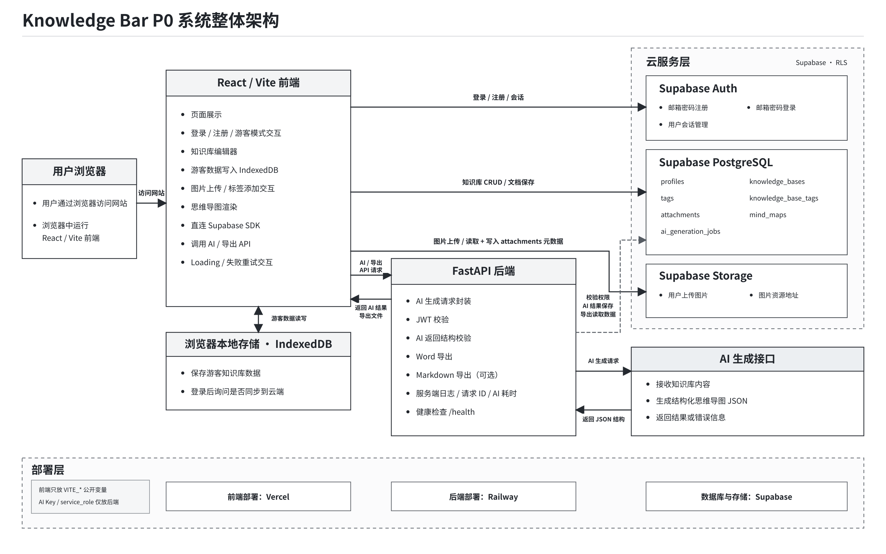
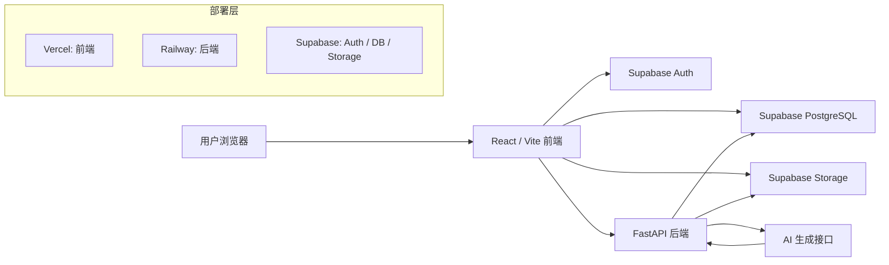
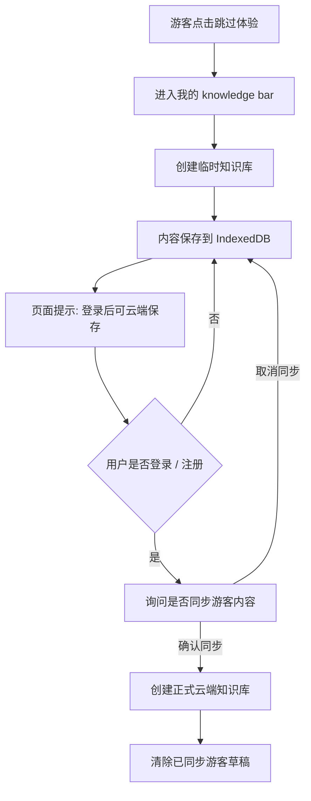
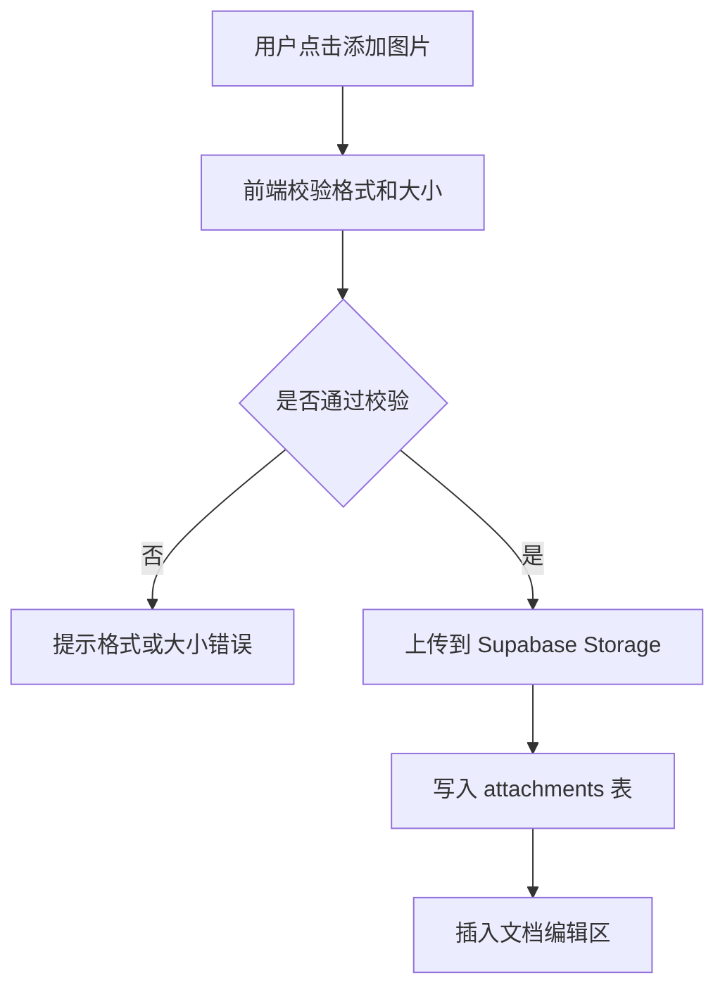
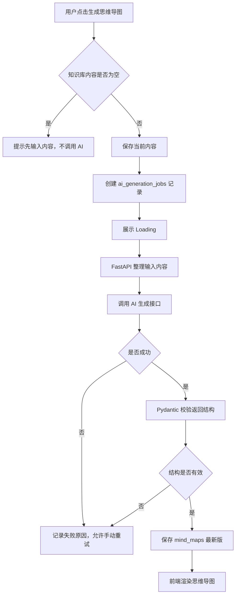
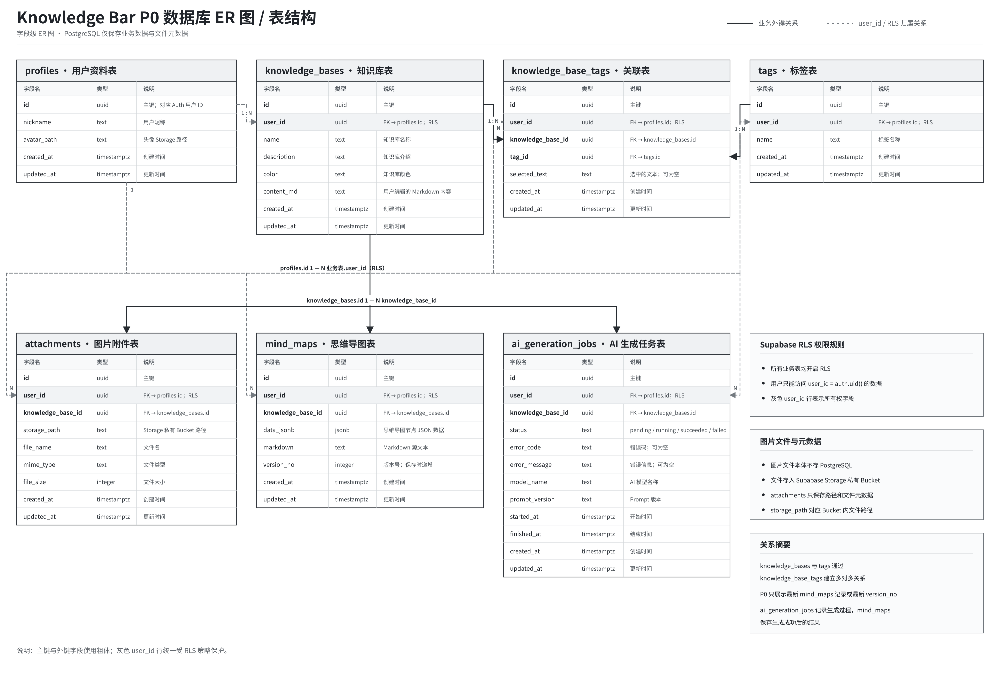

# Knowledge Bar P0 技术架构与数据库设计文档

## 1. 文档目标

本文档用于说明 Knowledge Bar P0 第一版的技术实现方案，包括：

- 前端：React + Vite + TypeScript
- 后端：Python + FastAPI
- 认证与数据：Supabase Auth + Supabase PostgreSQL + Supabase Storage
- AI 能力：通过后端统一 AI 生成接口生成思维导图 JSON
- 部署：前端 Vercel，后端 Railway，数据库 / Auth / Storage 使用 Supabase

本文档的目标是帮助开发阶段明确系统结构、前后端边界、数据模型、权限规则、AI 生成链路和部署方案，避免开发过程中频繁返工。

### 1.1 相关文档

| 文档 | 说明 |
| --- | --- |
| [Knowledge Bar P0 第一版 PRD](knowledge-bar-p0-prd.md) | 产品目标、用户流程、页面交互、功能范围和验收标准 |
| [Knowledge Bar P0 接口设计文档](knowledge-bar-p0-api-design.md) | Supabase 调用边界、FastAPI 接口、AI 生成接口、错误码和权限校验 |

## 2. 技术栈选型

| 模块 | 技术选型 | 选择原因 | P0 是否使用 |
| --- | --- | --- | --- |
| 前端 | React + Vite + TypeScript | React 适合构建交互式 SaaS 页面；Vite 启动快、配置轻；TypeScript 降低接口和数据结构错误 | 是 |
| 路由 | React Router | 支持登录页、工作台、创建页、详情页、思维导图页等页面切换 | 是 |
| 思维导图 | React Flow + Dagre / d3-hierarchy | React Flow 支持节点、缩放、拖动和自定义节点；自动布局可由 Dagre 或 d3-hierarchy 支持 | 是 |
| 后端 | Python + FastAPI | FastAPI 适合快速开发 API，类型提示清晰，方便接 AI、导出和结构校验 | 是 |
| 数据库 | Supabase PostgreSQL | 支持结构化业务数据、多用户隔离、RLS 权限控制，适合 SaaS 产品 | 是 |
| 认证 | Supabase Auth | 支持邮箱密码注册、登录、退出和用户会话管理，减少自建账号成本 | 是 |
| 文件存储 | Supabase Storage | 用于存储用户上传图片，数据库只保存路径和元数据 | 是 |
| AI 接口 | 后端 AI Provider Adapter | 由 FastAPI 统一封装 AI 调用，避免密钥暴露，并统一处理超时、校验和失败 | 是 |
| 导出 | FastAPI + python-docx | Word 导出由后端生成；Markdown 可前端生成，也可统一走后端 | 是 |
| 前端部署 | Vercel | 对 React/Vite 友好，部署简单，适合作品集展示 | 是 |
| 后端部署 | Railway + Dockerfile | 统一后端运行环境、环境变量和健康检查，P0 先固定一个平台 | 是 |

### 2.1 关于 SQLite 与 PostgreSQL

本地开发阶段可以使用 SQLite 快速验证后端逻辑，但正式上线建议使用 Supabase PostgreSQL。

原因：

1. Knowledge Bar 是 SaaS 产品，需要多用户数据隔离。
2. PostgreSQL 更适合云端部署和长期扩展。
3. Supabase 同时提供 Auth、数据库、Storage 和 RLS 权限能力。
4. SQLite 更适合本地单机开发，不适合作为线上多用户产品数据库。

## 3. 系统整体架构

Knowledge Bar P0 采用前后端分离架构。前端负责产品交互和普通数据操作；后端负责 AI、导出、密钥相关能力和需要统一校验的业务。



该架构图说明 Knowledge Bar P0 的前端、后端、Supabase 云服务、AI 生成接口和部署层之间的调用关系。P0 中，前端通过 Supabase SDK 直接处理认证、普通知识库 CRUD、文档保存和图片上传；FastAPI 后端只处理 AI 生成、导出文件、JWT 校验、AI 结果结构校验和服务端日志等需要密钥或服务端能力的操作。



### 3.1 架构职责

| 模块 | 职责 |
| --- | --- |
| React / Vite 前端 | 页面展示、用户交互、编辑器、思维导图渲染、调用 Supabase 和 FastAPI |
| Supabase Auth | 邮箱注册、邮箱登录、退出登录、用户会话 |
| Supabase PostgreSQL | 存储用户资料、知识库、文档、标签、思维导图、AI 生成记录 |
| Supabase Storage | 存储用户上传图片 |
| FastAPI 后端 | AI 生成、Word 导出、Markdown 导出、AI 返回结构校验、服务端日志 |
| AI 生成接口 | 将知识库内容整理成结构化思维导图 JSON |
| Vercel | 部署前端 |
| Railway | 部署 FastAPI 后端 |

### 3.2 AI 接口为什么放在后端

P0 中 AI 生成接口必须由 FastAPI 后端调用，而不是前端直接调用。

原因：

1. 避免 AI API Key 暴露在浏览器。
2. 后端可以统一处理内容清洗、提示词、失败重试和返回格式校验。
3. 后端可以记录 AI 生成任务状态并保存结果。
4. 后续如果增加次数限制、会员限制或日志统计，更容易扩展。

## 4. 前后端边界

P0 推荐采用下面的边界，避免同一个操作一会儿走前端直连数据库，一会儿走 FastAPI。

| 操作 | 负责方 | 原因 |
| --- | --- | --- |
| 注册 / 登录 / 退出 | 前端 -> Supabase Auth | Supabase Auth 已提供认证能力 |
| 获取用户会话 | 前端 -> Supabase Auth | 前端需要判断登录状态 |
| 知识库普通 CRUD | 前端 -> Supabase PostgreSQL | 在 RLS 保护下减少后端开发量 |
| 文档内容保存 | 前端 -> Supabase PostgreSQL | 属于普通用户数据写入 |
| 标签管理 | 前端 -> Supabase PostgreSQL | 属于普通用户数据写入 |
| 图片上传 | 前端 -> Supabase Storage | Storage 可结合用户权限控制 |
| AI 生成思维导图 | 前端 -> FastAPI -> AI | AI Key 不能暴露，返回结构需要后端校验 |
| Word 导出 | 前端 -> FastAPI | 由后端生成 .docx 文件 |
| Markdown 导出 | 前端或 FastAPI | P0 可先前端生成；若要统一导出逻辑，可走后端 |
| 日志 / 健康检查 | FastAPI | 便于部署平台检测服务状态 |

### 4.1 前端可以保存的环境变量

Vite 中以 `VITE_` 开头的环境变量会进入浏览器代码，因此前端只能保存公开配置：

| 可放前端 | 不可放前端 |
| --- | --- |
| Supabase URL | AI API Key |
| Supabase publishable / anon key | Supabase service_role key |
| FastAPI 公网地址 | 数据库密码 |
| 前端公开功能开关 | 任何后端私钥 |

## 5. 游客模式设计

游客模式必须单独设计，不写入 Supabase 云端数据。

### 5.1 游客数据流程



### 5.2 游客模式规则

| 规则 | 说明 |
| --- | --- |
| 保存位置 | 浏览器 IndexedDB |
| 不使用 localStorage | localStorage 容量较小，不适合保存完整知识内容和图片数据 |
| 不写入 Supabase | 游客未登录，无法建立稳定用户归属 |
| 云端保存提示 | 工作台、详情页、设置页需要提示“登录后可云端保存” |
| 登录后同步 | 用户登录或注册后，询问是否同步游客内容到账号 |
| 同步防重复 | 同一个游客草稿需要有 local_draft_id，避免重复同步 |
| 登录失败 | 不能删除游客草稿 |
| 同步成功 | 创建正式知识库后，可清除已同步的游客草稿 |

## 6. 图片与文件存储设计

图片不能直接存入 PostgreSQL。P0 使用 Supabase Storage 私有 Bucket 存储图片文件，数据库只保存文件路径和元数据。

### 6.1 图片上传流程



### 6.2 attachments 表保存内容

| 字段 | 说明 |
| --- | --- |
| id | 附件唯一 ID |
| user_id | 所属用户 |
| knowledge_base_id | 所属知识库 |
| storage_path | Supabase Storage 文件路径 |
| file_name | 原始文件名 |
| mime_type | 文件类型 |
| file_size | 文件大小 |
| created_at | 创建时间 |

## 7. AI 生成链路设计

P0 暂时不需要 Redis、Celery 或独立异步微服务，先使用 FastAPI 同步调用 AI。以后生成时间变长或用户量增加，再升级成队列。

### 7.1 AI 生成流程



### 7.2 AI 生成状态

| 状态 | 说明 |
| --- | --- |
| pending | 已创建生成记录，但未开始调用 |
| running | 正在调用 AI |
| succeeded | 生成成功并已保存结果 |
| failed | 生成失败，已记录错误原因 |

### 7.3 思维导图 JSON Schema

P0 固定思维导图数据格式，后端必须校验 AI 返回结构，不能把任意文本直接交给前端渲染。

```json
{
  "title": "知识库名称",
  "nodes": [
    {
      "id": "node-1",
      "parentId": null,
      "text": "中心主题",
      "order": 1
    },
    {
      "id": "node-2",
      "parentId": "node-1",
      "text": "主题 A",
      "order": 1
    }
  ]
}
```

### 7.4 AI 失败处理

| 失败类型 | 处理方式 |
| --- | --- |
| 内容为空 | 不调用 AI，提示先输入内容 |
| AI 超时 | 设置任务为 failed，提示超时并允许重试 |
| AI 返回非 JSON | 设置任务为 failed，提示生成格式错误 |
| JSON 校验失败 | 设置任务为 failed，提示结构无效 |
| 网络失败 | 设置任务为 failed，提示网络异常 |
| 用户重复点击 | 生成中禁用按钮，避免重复请求 |

## 8. 数据库表结构设计

Knowledge Bar P0 使用 Supabase PostgreSQL 存储业务数据，并通过 Row Level Security 保证用户只能访问自己的数据。图片文件本体存储在 Supabase Storage 中，PostgreSQL 只保存图片路径和元数据。



### 8.1 表总览

| 表名 | 作用 |
| --- | --- |
| profiles | 用户资料扩展 |
| knowledge_bases | 知识库基础信息 |
| tags | 标签 |
| knowledge_base_tags | 知识库和标签关联 |
| attachments | 图片附件元数据 |
| mind_maps | 思维导图最新数据 |
| ai_generation_jobs | AI 生成任务记录 |

所有业务表都需要包含：

- `id`
- `user_id`
- `created_at`
- `updated_at`

### 8.2 profiles

| 字段 | 类型建议 | 说明 |
| --- | --- | --- |
| id | uuid | 对应 Supabase Auth 用户 ID |
| nickname | text | 用户昵称 |
| avatar_path | text | 头像 Storage 路径 |
| created_at | timestamptz | 创建时间 |
| updated_at | timestamptz | 更新时间 |

### 8.3 knowledge_bases

| 字段 | 类型建议 | 说明 |
| --- | --- | --- |
| id | uuid | 知识库 ID |
| user_id | uuid | 所属用户 ID |
| name | text | 知识库名称 |
| description | text | 知识库介绍 |
| color | text | 知识库颜色 |
| content_md | text | 用户编辑的 Markdown 内容 |
| created_at | timestamptz | 创建时间 |
| updated_at | timestamptz | 更新时间 |

说明：P0 可以把正文直接放在 `knowledge_bases.content_md`，减少表数量。后续如果需要文档历史、多文档知识库，再拆出 `documents` 表。

### 8.4 tags

| 字段 | 类型建议 | 说明 |
| --- | --- | --- |
| id | uuid | 标签 ID |
| user_id | uuid | 所属用户 ID |
| name | text | 标签名称 |
| created_at | timestamptz | 创建时间 |
| updated_at | timestamptz | 更新时间 |

### 8.5 knowledge_base_tags

| 字段 | 类型建议 | 说明 |
| --- | --- | --- |
| id | uuid | 关联 ID |
| user_id | uuid | 所属用户 ID |
| knowledge_base_id | uuid | 知识库 ID |
| tag_id | uuid | 标签 ID |
| selected_text | text | 添加标签时选中的文本，可选 |
| created_at | timestamptz | 创建时间 |
| updated_at | timestamptz | 更新时间 |

### 8.6 attachments

| 字段 | 类型建议 | 说明 |
| --- | --- | --- |
| id | uuid | 附件 ID |
| user_id | uuid | 所属用户 ID |
| knowledge_base_id | uuid | 所属知识库 |
| storage_path | text | Supabase Storage 路径 |
| file_name | text | 文件名 |
| mime_type | text | 文件类型 |
| file_size | integer | 文件大小 |
| created_at | timestamptz | 创建时间 |
| updated_at | timestamptz | 更新时间 |

### 8.7 mind_maps

| 字段 | 类型建议 | 说明 |
| --- | --- | --- |
| id | uuid | 思维导图 ID |
| user_id | uuid | 所属用户 ID |
| knowledge_base_id | uuid | 所属知识库 |
| data_jsonb | jsonb | 思维导图节点数据 |
| markdown | text | Markdown 源文本 |
| version_no | integer | 版本号，保存最新版时递增 |
| created_at | timestamptz | 创建时间 |
| updated_at | timestamptz | 更新时间 |

### 8.8 ai_generation_jobs

| 字段 | 类型建议 | 说明 |
| --- | --- | --- |
| id | uuid | 生成任务 ID |
| user_id | uuid | 所属用户 ID |
| knowledge_base_id | uuid | 所属知识库 |
| status | text | pending / running / succeeded / failed |
| error_code | text | 错误码 |
| error_message | text | 错误信息 |
| model_name | text | 使用的 AI 模型 |
| prompt_version | text | Prompt 版本 |
| started_at | timestamptz | 开始时间 |
| finished_at | timestamptz | 结束时间 |
| created_at | timestamptz | 创建时间 |
| updated_at | timestamptz | 更新时间 |

## 9. RLS 与权限规则

P0 必须开启 PostgreSQL Row Level Security，保证用户只能访问自己的数据。

### 9.1 基础权限规则

| 规则 | 说明 |
| --- | --- |
| 查询 | 用户只能查询 `user_id = auth.uid()` 的业务数据 |
| 新增 | 新增数据时 `user_id` 必须等于当前登录用户 |
| 更新 | 用户只能更新自己的数据 |
| 删除 | 用户只能删除自己的数据 |
| Storage | 用户只能读取、上传、删除自己路径下的文件 |
| service_role | 只能存在 FastAPI 后端，不能进入前端 |

### 9.2 示例 RLS 策略

```sql
create policy "Users can read own knowledge bases"
on knowledge_bases
for select
to authenticated
using ((select auth.uid()) is not null and (select auth.uid()) = user_id);

create policy "Users can insert own knowledge bases"
on knowledge_bases
for insert
to authenticated
with check ((select auth.uid()) is not null and (select auth.uid()) = user_id);

create policy "Users can update own knowledge bases"
on knowledge_bases
for update
to authenticated
using ((select auth.uid()) is not null and (select auth.uid()) = user_id)
with check ((select auth.uid()) is not null and (select auth.uid()) = user_id);

create policy "Users can delete own knowledge bases"
on knowledge_bases
for delete
to authenticated
using ((select auth.uid()) is not null and (select auth.uid()) = user_id);
```

## 10. 核心 API 设计

### 10.1 FastAPI 接口

| 方法 | 路径 | 说明 |
| --- | --- | --- |
| GET | `/health` | 健康检查 |
| POST | `/api/ai/mindmap/generate` | 生成思维导图 |
| POST | `/api/export/word` | 导出 Word |
| POST | `/api/export/markdown` | 导出 Markdown，可选 |

### 10.2 AI 生成接口请求

```json
{
  "knowledge_base_id": "uuid",
  "title": "知识库名称",
  "description": "知识库介绍",
  "content_md": "用户输入的正文内容"
}
```

### 10.3 AI 生成接口响应

```json
{
  "generation_id": "uuid",
  "status": "succeeded",
  "mind_map": {
    "title": "知识库名称",
    "nodes": [
      {
        "id": "node-1",
        "parentId": null,
        "text": "中心主题",
        "order": 1
      }
    ]
  }
}
```

### 10.4 错误码

| 错误码 | 说明 |
| --- | --- |
| `EMPTY_CONTENT` | 知识库内容为空 |
| `AI_TIMEOUT` | AI 生成超时 |
| `AI_FORMAT_INVALID` | AI 返回格式无效 |
| `AI_PROVIDER_ERROR` | AI 服务错误 |
| `UNAUTHORIZED` | 未登录或 Token 无效 |
| `FORBIDDEN` | 无权访问该知识库 |
| `EXPORT_FAILED` | 文件导出失败 |

## 11. 后端安全与 JWT 校验

前端登录后会获得 Supabase JWT。调用 FastAPI 时，前端需要在请求头中携带：

```text
Authorization: Bearer <supabase_jwt>
```

FastAPI 必须验证 JWT，不能只相信前端传来的 `user_id`。

后端需要校验：

1. Token 是否有效。
2. Token 中用户 ID 是否存在。
3. 请求的 `knowledge_base_id` 是否属于该用户。
4. AI 密钥、Supabase service_role key、数据库密码只能存在后端环境变量中。

## 12. 部署方案

### 12.1 部署选择

| 模块 | 平台 |
| --- | --- |
| 前端 | Vercel |
| 后端 | Railway |
| 数据库 | Supabase PostgreSQL |
| 认证 | Supabase Auth |
| 文件存储 | Supabase Storage |

### 12.2 必要配置

| 配置 | 说明 |
| --- | --- |
| FastAPI `/health` | Railway 健康检查使用 |
| CORS 白名单 | 添加 Vercel 正式域名、本地开发域名 |
| 环境变量 | 前后端环境变量分开管理 |
| Supabase RLS | 所有业务表开启 RLS |
| Storage Bucket | 图片使用私有 Bucket |
| 数据库地区 | Railway 与 Supabase 尽量选择相近地区 |

### 12.3 前端环境变量

```text
VITE_SUPABASE_URL=
VITE_SUPABASE_ANON_KEY=
VITE_API_BASE_URL=
```

### 12.4 后端环境变量

```text
SUPABASE_URL=
SUPABASE_SERVICE_ROLE_KEY=
SUPABASE_JWT_SECRET=
AI_API_KEY=
AI_MODEL_NAME=
ALLOWED_ORIGINS=
```

## 13. 日志与监控

P0 不做复杂监控，但需要最小可排查能力。

| 项目 | 说明 |
| --- | --- |
| `/health` | 检查后端服务是否存活 |
| request_id | 每个请求生成唯一 ID，便于定位问题 |
| AI 耗时 | 记录 AI 生成开始和结束时间 |
| AI 错误 | 记录错误码和错误信息 |
| 导出错误 | 记录导出失败原因 |
| 后续规划 | P1 可接入 Sentry 或平台日志告警 |

## 14. 开发里程碑

| 阶段 | 目标 | 产出 |
| --- | --- | --- |
| M1 | 项目骨架 | React/Vite 前端、FastAPI 后端、Supabase 项目 |
| M2 | 账号与权限 | Auth、RLS、profiles、登录注册流程 |
| M3 | 知识库 CRUD | 创建、列表、搜索、详情、删除 |
| M4 | 编辑器与图片 | 自由编辑、保存、IndexedDB 游客草稿、Storage 图片上传 |
| M5 | AI 生成 | FastAPI AI 接口、Pydantic 校验、思维导图渲染 |
| M6 | 导出与部署 | Markdown / Word 导出、Vercel + Railway 上线 |

## 15. 待确认问题

| 问题 | 当前建议 | 需要确认 |
| --- | --- | --- |
| AI Provider | 先抽象成 AI 生成接口 | 具体 API Key 和模型名称 |
| Markdown 导出 | P0 可前端生成 | 是否统一放后端 |
| 游客同步 | 登录后弹窗询问同步 | 同步文案和交互细节 |
| 图片上限 | 单张 5MB | 是否需要更严格限制 |
| 思维导图库 | React Flow | 是否接受该实现选型 |
| 部署后端 | Railway | 是否最终固定 Railway |

## 16. 参考资料

| 资料 | 用途 |
| --- | --- |
| [Vite Env Variables and Modes](https://vite.dev/guide/env-and-mode) | 确认 `VITE_*` 环境变量会暴露到浏览器，前端不能放密钥 |
| [Supabase Row Level Security](https://supabase.com/docs/guides/database/postgres/row-level-security) | 确认 RLS、`auth.uid()`、用户只能访问自己数据的策略写法 |
| [Supabase Storage](https://supabase.com/docs/guides/storage) | 确认文件应存储在 Storage 中，并支持访问控制 |
| [Supabase Storage Access Control](https://supabase.com/docs/guides/storage/security/access-control) | 确认 Storage 可通过 RLS policy 控制上传和读取 |
| [FastAPI Background Tasks](https://fastapi.tiangolo.com/tutorial/background-tasks/) | 确认 P0 可同步生成，复杂任务后续再升级队列 |
| [Railway FastAPI Guide](https://docs.railway.com/guides/fastapi) | 确认 FastAPI 可部署到 Railway |
| [Railway Healthchecks](https://docs.railway.com/deployments/healthchecks) | 确认 `/health` 健康检查配置 |
| [React Flow Mind Map Tutorial](https://reactflow.dev/learn/tutorials/mind-map-app-with-react-flow) | 确认 React Flow 适合实现可编辑思维导图 |
